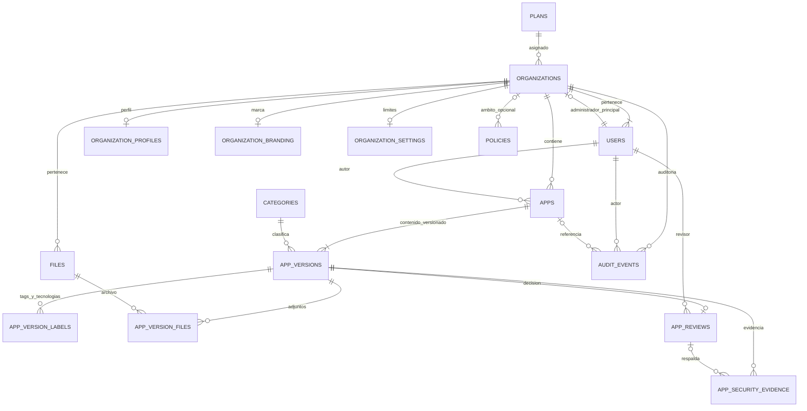
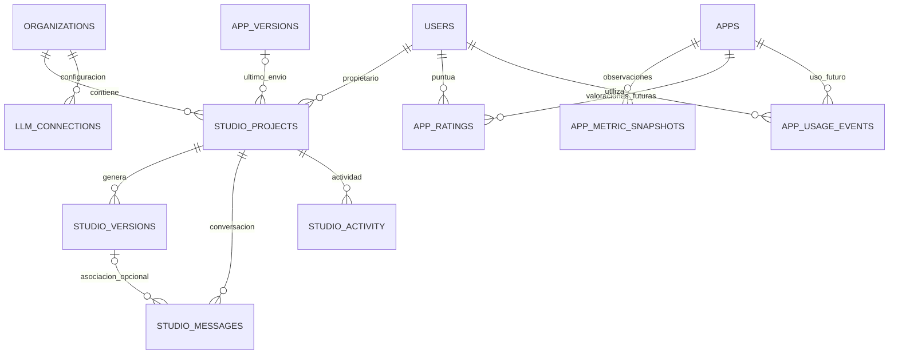
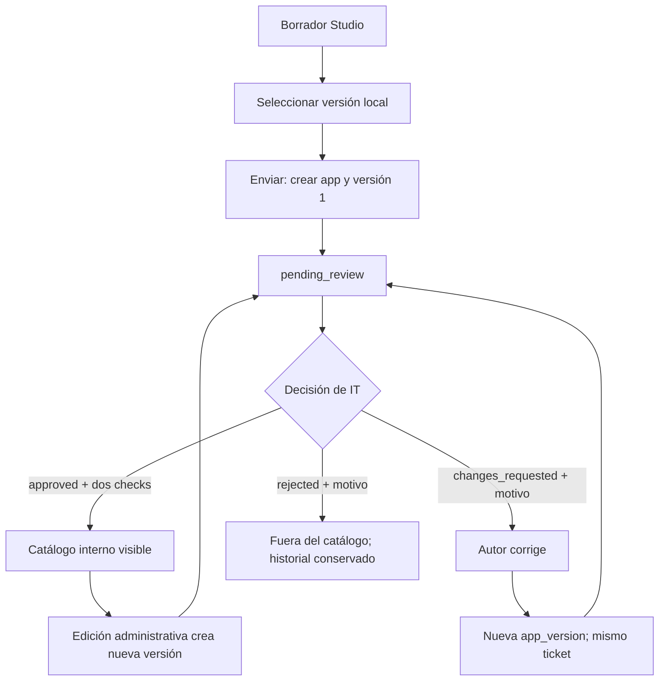

# Tektonik hub: mapa de datos y base PostgreSQL

**Fecha del análisis:** 25 de octubre de 2026.  
**Alcance:** todos los HTML propios de esta carpeta, sus scripts funcionales y la fuente compartida `data.json`.  
**Resultado:** propuesta de construcción, no backend desplegado. Ningún HTML ni dato original ha sido modificado.

**Nota de archivo:** el análisis y la evidencia siguientes describen el prototipo conservado en `Old`. Las referencias a HTML, `assets`, `server\local.cjs` y su README se interpretan relativas a esa carpeta. La aplicación vigente es Next.js/React, independiente de ese archivo; este modelo PostgreSQL sigue siendo la base para su futura integración con InsForge.

## 1. Recomendación principal

Construir una **base relacional multiempresa**, con `organizations` como frontera de aislamiento. La aplicación es el activo estable; su contenido pertenece a versiones. Una revisión debe identificar la versión exacta, nunca solo el título o el HTML actual.

No recomiendo una tabla por página ni guardar toda la demo en una columna JSON. Las páginas son vistas sobre las mismas entidades. Reservar JSONB para configuración de marca, especificaciones de Studio, configuración declarativa de dashboards y metadatos de eventos.

Entregables:

- `MAPA_POSTGRESQL.md`: este mapa, decisiones, flujos, permisos y migración.
- `DICCIONARIO_DATOS.md`: todas las columnas y restricciones, generado del SQL entregado.
- `001_initial_schema.sql`: 25 tablas, claves, índices, restricciones, triggers, 2 vistas y función transaccional de revisión.
- `validate-schema.cjs`: validación reproducible contra PostgreSQL embebido, sin tocar un servidor real.

## 2. Inventario completo de HTML

Se han encontrado **14 HTML**: los **8 del producto** que siguen y **6 de Playwright** dentro de `node_modules`. Los segundos son herramientas de trazas, grabación e informes; no representan entidades del negocio y se excluyen del modelo.

| Página | Qué hace realmente | Datos que necesita | Tablas propuestas |
|---|---|---|---|
| `index.html` | Landing comercial, ejemplos, planes, traducciones, enlaces al acceso | Textos ES/EN, ejemplos, información comercial; no altas reales | `plans` si se conecta precio real; `content_translations` opcional |
| `login.html` | Selecciona rol ficticio; email, SSO y MFA son simulaciones | Identidad, rol, empresa, idioma; futura identidad de proveedor | `users`, `organizations`; autenticación delegada a proveedor |
| `profile.html` | Perfil del creador, apps aprobadas, ficha e historial; enlace para corregir envíos propios | Usuario, bio opcional, departamento, apps, versiones, decisiones | `users`, `apps`, `app_versions`, `app_reviews`, vista `catalog_apps` |
| `company-profile.html` | Perfil de empresa, lista pública de apps/creadores y CRUD administrativo | Perfil, organización, usuarios, autores, categorías, apps, métricas | `organization_profiles`, `organizations`, `users`, `apps`, `app_versions` |
| `app-catalog.html` | Catálogo de apps aprobadas; búsqueda, filtros, grid/lista, ficha y valoración de demo | Apps, autor, categoría, madurez, etiquetas, valoración | `catalog_apps`, `users`, `categories`, `app_version_labels`, `app_metric_snapshots` |
| `create-app.html` | Studio: conversación, preview, exportación, versiones locales y envío a IT | Proyecto, mensajes, versiones, especificación, motor/modelo, HTML, ticket | `studio_projects`, `studio_messages`, `studio_versions`, `studio_activity`, `apps`, `app_versions`, `files` |
| `admin.html` | Oficina de IA: apps, políticas de empresa, cola de revisión, historial, marca y Azure local | Apps/versiones, revisiones, políticas, tokens de marca, conexión LLM | `apps`, `app_versions`, `app_reviews`, `policies`, `organization_branding`, `llm_connections`, `audit_events` |
| `super-admin.html` | CRUD de empresas, usuarios, planes, políticas globales y estados; exporta snapshot | Empresas, administrador principal, usuarios, planes, políticas, contadores | `organizations`, `users`, `plans`, `policies`, vista `organization_metrics`, `audit_events` |

### Flujo del prototipo analizado

```text
data.json → assets\js\data-store.js → window.BLK → 8 HTML
                         ↕
            localStorage + sessionStorage

create-app.html → borradores Studio en localStorage
admin.html / Studio → server\local.cjs → Azure OpenAI opcional
```

El servidor Node únicamente ofrece el proxy/configuración local de Azure; **no es un backend de negocio**. Las credenciales están en memoria del proceso, no en PostgreSQL.

El JSON inicial contiene **6 organizaciones, 21 usuarios, 16 aplicaciones (13 aprobadas y 3 pendientes), 13 revisiones, 3 planes, 10 categorías, 0 políticas y 0 eventos**. Una colección vacía no significa que su funcionalidad no exista: las políticas y eventos se crean durante el uso de la demo.

## 3. Mapa entidad-relación: núcleo



**Reglas para interpretar el mapa:**

- Un usuario pertenece a **una** organización, como en la demo. No se añade multiorganización por usuario sin necesidad confirmada.
- `admin_id` pertenece obligatoriamente a la misma organización y debe ser admin/superadmin activo.
- `apps.current_version` apunta a una fila de `app_versions` de la propia aplicación.
- La combinación `(org_id, author_id)` impide autores de otra empresa.
- Una decisión terminal por versión es suficiente para el flujo actual. Pedir cambios y reenviar crea otra versión; comentarios o revisores múltiples requerirían un módulo adicional.
- Un superadmin puede revisar apps de otra organización; el revisor no tiene una FK de tenant restrictiva. La función de revisión valida su rol y ámbito.
- Política con `org_id IS NULL` = global; con `org_id` = corporativa. No implica ejecución automática de reglas.

## 4. Mapa Studio y ampliaciones



`content_translations` es un catálogo independiente por página, idioma y clave; no representa usuarios ni actividad. No hace falta una FK a un HTML del disco.

## 5. Diccionario resumido de las 25 tablas

Los tipos exactos, nulabilidad, valores por defecto y checks de cada columna están en [DICCIONARIO_DATOS.md](DICCIONARIO_DATOS.md) y en el SQL.

### A. Núcleo operativo: 16 tablas

| Tabla | Clave y contenido | Origen/decisión |
|---|---|---|
| `plans` | UUID, ID legado, nombre, precio nullable, moneda, periodo, fecha | Nombre/precio actuales; moneda y periodo explícitos propuestos. `NULL` = consultar, no gratis |
| `organizations` | UUID, ID legado, nombre, dominio, plan, estado, salud, administrador, miembros declarados, fechas, revisión y borrado lógico | Empresa actual; separar `active-amber` en estado activo + aviso |
| `users` | UUID, ID legado, empresa, nombre, email, departamento, bio, rol, idioma, proveedor/subject externo, último acceso, fechas/desactivación | Datos actuales y preferencias/identidad externa propuestas. No contraseñas |
| `organization_profiles` | PK/FK empresa, bio, título/descripción de banner, actualización | `org.profile` opcional; borrar perfil no borra empresa |
| `organization_branding` | PK/FK empresa, tokens JSONB, actualización | `org.brand`; backend debe validar nombres/colores/fuentes, no aceptar CSS arbitrario |
| `organization_settings` | PK/FK empresa, máximo de archivos/bytes, actualización | Límites actuales globales; se propone configurarlos por empresa |
| `categories` | ID legible, etiqueta, orden | Los 10 IDs de `data.json`, no todas las etiquetas comerciales del HTML |
| `policies` | UUID, ID legado, empresa nullable, nombre, descripción, habilitada, versión, fechas | Políticas globales/corporativas actuales; informativas |
| `apps` | UUID, ID legado, empresa, autor, ticket único, versión actual, estado de revisión, madurez, fechas/borrado lógico | Activo estable; no duplicar título/HTML de versión |
| `app_versions` | PK `(app_id, version)`, empresa, categoría, textos, URL, HTML, dashboard JSON, motor/modelo, creador y fecha | Snapshot de contenido. La demo sobrescribe contenido; se propone conservarlo |
| `app_version_labels` | PK app/versión/tipo/etiqueta, posición | Arrays `tags` y `tech`, sin catálogo administrable innecesario |
| `files` | UUID, empresa, uploader, nombre, bytes, MIME, bucket/key opcionales, hash y fecha | Hoy solo metadatos; almacenamiento de objetos futuro, no `bytea` obligatorio |
| `app_version_files` | PK app/versión/archivo, empresa, posición | Adjuntos de la versión revisada; misma empresa y límites totales |
| `app_reviews` | UUID, app/versión únicos, revisor, acción, motivo, entorno, dos checks manuales, fecha | Decisión por versión; añadir checks persistentes para trazabilidad |
| `app_security_evidence` | UUID, app/versión, revisión opcional, etiqueta, certificado/referencia, URL, fuente, fecha | `security`/`certificate`; fuente `demo` no es certificación real |
| `audit_events` | UUID, empresa, actor, app opcional, acción, metadata JSONB, fecha | `events`; historial propuesto append-only |

### B. Studio y LLM: 5 tablas

| Tabla | Clave y contenido | Origen/decisión |
|---|---|---|
| `studio_projects` | UUID, ID legado, empresa, propietario, título, versión seleccionada, app/versión del último envío, revisión, fechas | Un borrador se convierte en proyecto persistente; se permiten varios por usuario |
| `studio_versions` | PK proyecto/versión, prompt, HTML, dashboard JSON, motor, modelo, plantilla, spec JSON, resumen, fecha | Versiones locales y procedencia. No mezclar su numeración con versiones del ticket |
| `studio_messages` | UUID, proyecto, posición única, rol, body, versión opcional, fecha | Chat del borrador; `system` es ampliación opcional del esquema |
| `studio_activity` | UUID, proyecto, acción, mensaje, fecha | Registro de actividad persistente propuesto, no estado visual `generating` |
| `llm_connections` | UUID, empresa/proveedor únicos, endpoint Azure, deployment, API version, referencia de secreto, estado, prueba/fechas | Sustitución futura de configuración en memoria. No contiene API keys |

### C. Opcionales: 4 tablas

| Tabla | Clave y contenido | Cuándo usarla |
|---|---|---|
| `app_metric_snapshots` | UUID, app, fecha única por app, horas, usuarios activos, valoración, fuente y metodología | Conservar fixtures como `demo` o incorporar medición con procedencia |
| `app_ratings` | PK app/usuario, empresa, score 1–5, fechas | Solo al implementar votos reales; hoy el usuario no puntúa |
| `app_usage_events` | UUID, empresa/app/usuario, tipo, duración, fecha | Solo al implementar telemetría. No hay runtime real desde catálogo |
| `content_translations` | PK página/idioma/clave, texto, actualización | Solo si se necesita un CMS/traducción desde DB; dejar textos en archivos también es válido |

El script crea todas para disponer de una propuesta completa. La prioridad de implementación es **A → B**; C puede permanecer vacía.

## 6. Decisiones que evitan errores de diseño

### Estados distintos

- `organizations.status`: `active`, `suspended`, `pending`.
- `organizations.health_status`: `normal`, `warning`.
- `apps.review_status`: `pending_review`, `changes_requested`, `rejected`, `approved`.
- `apps.maturity`: `new`, `beta`, `approved`.

`beta` o `new` no significan pendiente de aprobación. Una app aprobada puede estar etiquetada como beta. No añadir estados `published`, `in_review` o `draft` al flujo de negocio actual sin definir nuevas operaciones. Un borrador Studio sin enviar todavía no es una app del catálogo.

### La versión de Studio no es la versión enviada

Studio guarda versiones generadas, selecciona una y la envía. El ticket tiene su propia secuencia de versiones revisables. Guardar `submitted_app_id` + `submitted_version` evita confundir «versión local 5» con «versión del envío 2».

La demo retiene hasta **8 versiones y 40 mensajes** del borrador; son límites del almacenamiento local. Se propone conservar todo el historial en PostgreSQL y definir retención/cuotas en backend, en vez de copiar silenciosamente esos límites. Mantener el frontend actual seguirá limitando lo que muestra o conserva localmente hasta integrar la API.

### Métricas y presentación

No usar como fuente primaria:

- `apps`, `pending` y `members` como contadores duplicados de organización.
- Iniciales, nombres de autor, etiquetas de categoría, precios formateados, `4.9`, `—`, `3.840h`, «Hace 2 horas».
- Búsqueda activa, grid/lista, filtros, toasts, progreso de generación y estado de preview.
- KPIs comerciales de landing, «99,8% compliance», SOC2/GDPR/DLP, ROI y ahorros de ejemplo.

`declared_member_count` conserva el tamaño declarado de la empresa: **3.820 miembros anunciados no equivalen a 3.820 usuarios registrados**. `organization_metrics.registered_members` cuenta usuarios activos realmente cargados.

Los ratings del seed son strings de demo. Convertir a número o `NULL` al importar; no crear votos inexistentes. `compliance` no tiene algoritmo real y no se incorpora como verdad en el esquema. Para una futura medición se necesitarán evidencias, denominador, periodo y metodología.

### HTML, JSON y archivos

- HTML generado: `text` con límite de 300.000 caracteres. Es contenido no confiable; almacenarlo no autoriza su ejecución.
- Dashboard: JSONB declarativo. Validarlo con el kit de Tektonik hub en backend; el `CHECK` SQL solo comprueba que es objeto, no todo el catálogo.
- `spec`: configuración del motor demo, no datos operativos del cliente.
- Datos de tabla, kanban, formularios y calculadoras generadas: actualmente **sintéticos y temporales**. No crear tablas de facturas, contratos o SAP por sus ejemplos.
- Adjuntos: máximo actual 10 y 25 MiB por envío. El trigger aplica límites por versión y bloquea adjuntos de otra empresa. Metadata sin bucket/key representa la demo sin binarios.
- El mismo archivo puede referenciarse desde varias versiones; no copiar un binario por cada ticket.
- `secret_reference`: identificador en un gestor de secretos server-side; ni clave de Azure ni token de login en texto plano.

### Borrado

Se propone **borrado lógico de apps/organizaciones y desactivación de usuarios**, preservando revisiones, versiones y auditoría. Esto difiere deliberadamente de la demo, que elimina arrays e historial. No conectar «Eliminar» a un `DELETE` indiscriminado.

Los archivos y registros históricos son append-only en este esquema. Una política de purga legal/retención requerirá una migración/procedimiento privilegiado explícito; no la implementa el frontend actual.

## 7. Flujo de revisión y publicación



La propuesta conserva el comportamiento actual: editar una app aprobada la devuelve a revisión y **la retira del catálogo mientras tanto**. No se introduce una versión publicada antigua paralela a la nueva pendiente. Si se desea disponibilidad continua, habrá que añadir `published_version` y modificar esta regla.

### Transacciones que debe implementar el backend

1. **Alta de empresa:** insertar organización y administrador en la misma transacción. FK circular diferida; el trigger comprueba rol y tenant al confirmar.
2. **Crear envío:** verificar sesión/rol developer o admin autorizado, empresa activa y campos; insertar app + versión 1 + etiquetas/archivos + evento juntos.
3. **Corregir/reenvío:** bloquear app (`FOR UPDATE`), verificar `expected_version` y estado `changes_requested` para el autor; insertar snapshot N+1; cambiar versión actual/estado; añadir evento; confirmar.
4. **Edición administrativa:** mismo patrón de nueva versión, con autor developer de esa empresa y estado final pendiente.
5. **Revisar:** utilizar la función `blk_review_app`; bloquea app, comprueba revisor/tenant, empresa activa, versión y estado, inserta decisión y evento y cambia estado atómicamente.
6. **Política/empresa/proyecto:** actualizar solo si coincide versión/revisión esperada; devolver HTTP 409 al conflicto. El `updated_at` se mantiene con trigger, pero el backend debe incrementar estos contadores.
7. **Borrado lógico:** conservar historial, escribir evento y excluir del catálogo. Desactivar/borrar datos referenciados no debe romper FKs.

La función de revisión **no es un endpoint público**. `p_actor_id` debe provenir de la sesión autenticada que verifica el servidor, nunca del formulario. No dar permiso de ejecutarla a clientes: podrían suplantar ese parámetro.

Las reglas de autorización de creación, reenvío, usuarios, políticas, marca, selección de autor developer y validación completa de JSON/URL permanecen como trabajo de backend. El SQL no pretende reemplazarlas con validaciones insuficientes.

## 8. Permisos e identidad

| Acción | `catalog` | `developer` | `admin` | `superadmin` |
|---|---|---|---|---|
| Leer catálogo aprobado de empresa activa | Sí, propia | Sí, propia | Sí, propia | Según contexto autorizado |
| Crear/usar Studio | No en flujo actual | Propio | No como autor en flujo actual | No como autor en flujo actual |
| Enviar/corregir app propia con cambios solicitados | No | Sí | Mediante edición administrativa | Mediante edición administrativa |
| Leer envíos e historial propio | No | Sí | Empresa | Global |
| Crear/editar apps y usuarios developer/catalog | No | No | Empresa | Global |
| Aprobar/rechazar/pedir cambios | No | No | Empresa | Global |
| Editar perfil/marca/políticas corporativas | No | No | Empresa | Global |
| Gestionar organizaciones, planes y políticas globales | No | No | No | Sí |
| Configurar LLM | No | No | Empresa | Contexto autorizado |

**No hay autenticación real en `login.html`.** Para producción, delegar contraseñas, SSO, MFA, recuperación y sesiones a un proveedor de identidad. `auth_provider` + `auth_subject` enlazan el perfil con ese proveedor; este modelo inicial permite una identidad vinculada por usuario. Varias identidades exigirían `user_auth_identities` separada.

Si se elige InsForge, migrar/adaptar la FK del usuario al identificador administrado de `auth.users` y escribir políticas usando la identidad verificada del proveedor. El SQL entregado es PostgreSQL genérico y **no modifica esquemas gestionados ni depende de `auth.uid()`**.

### Protección inicial del SQL

- RLS activado en las 25 tablas, sin políticas: roles ordinarios no ven filas.
- Sin grants públicos de tablas/vistas ni ejecución pública de funciones.
- Vistas `security_invoker=true`: heredan permisos/RLS del lector.
- El propietario de migración puede operar para instalar/importar; no usar esas credenciales desde HTML.
- Antes de abrir una API directa, crear roles/grants mínimos y políticas SELECT/INSERT/UPDATE con `USING` y `WITH CHECK` basadas en identidad real.
- Con backend confiable, igualmente validar cada petición y tenant. **No considerar RLS finalizado** por haberlo activado: falta su integración con identidad.
- El cambio de contexto del superadmin no cambia su identidad; registrar acceso/suplantación autorizada en eventos. No reproducir `setRole` del navegador como login real.

## 9. Trazabilidad: pruebas de origen

| Dominio | Evidencia funcional |
|---|---|
| Colecciones, referencias y estados reales | `assets\js\data-store.js:7–47` |
| Identidad demo y consultas del catálogo | `assets\js\data-store.js:70–101` |
| Campos y límites del envío | `assets\js\data-store.js:102–118` |
| Crear/corregir/revisar y eventos | `assets\js\data-store.js:119–164` |
| Empresa, usuarios, planes y políticas | `assets\js\data-store.js:165–403` |
| Marca y sus tokens | `assets\js\data-store.js:404–431` |
| Oficina de IA, ficha/historial y formularios | `assets\js\admin-office.js:8–84`; `admin.html:982–992`, `1318–1334`, `1822–1843` |
| Superadmin, estados, planes, políticas y KPI demo | `assets\js\super-admin.js:7–8`, `25–32`, `73–81`, `112–165`; `super-admin.html:1017–1041` |
| Perfil de empresa y CRUD | `assets\js\company-profile.js:80–92`, `130–209`, `213–275`; `company-profile.html:625–710` |
| Login/MFA/SSO ficticios | `login.html:774–785`, `907–962` |
| Catálogo, filtros y sandbox sin ejecución | `app-catalog.html:859–918`, `961–992`, `1032–1043` |
| Perfil de usuario y bio opcional | `profile.html:1037–1045`, `1065–1121` |
| Borrador, versiones, generación y envío Studio | `assets\js\studio.js:28–65`, `217–247`, `278–303`, `339–362`; `create-app.html:139–150` |
| Plantillas demo y ausencia de datos persistidos dentro de preview | `assets\js\studio-engine.js:9–45`, `145–151`, `329–330` |
| Catálogo y validación dashboard | `assets\js\dashboard-kit.js:8–38`, `71–129` |
| Azure local y tratamiento de claves | `server\local.cjs:15–29`, `46–85`, `105–136`; `assets\js\llm-settings.js` |
| Landing de marketing vs producto conectado | `index.html` y `data.json → content.index`; `README.md`, apartados Arquitectura y Flujo objetivo |

Los reportes de pantallas pueden sugerir entidades futuras; el esquema usa como autoridad adicional el almacén compartido. Por ejemplo, no se crea un sistema de MFA porque existe un formulario simulado ni se convierten todos los sellos visuales en certificaciones.

## 10. Orden recomendado para construirlo

### Paso 1: revisar alcance y crear una base vacía

Elegir entorno PostgreSQL **15 o superior** dedicado. Crear la base con un administrador (no contiene `CREATE DATABASE` el script). No ejecutar sobre una base de producción existente: esta migración inicial no es idempotente y fallará si los nombres ya existen.

Con PostgreSQL instalado, ejemplo en PowerShell:

```powershell
psql --dbname=blk --set=ON_ERROR_STOP=1 --file="database\001_initial_schema.sql"
```

`blk` es el nombre de ejemplo de una base previamente creada. Configurar host/usuario/SSL mediante el mecanismo seguro de conexión del entorno; no poner contraseñas en scripts.

### Paso 2: importar datos sin confundir demo y producción

El SQL **no inserta usuarios ni datos de negocio**. Preparar una importación separada solo cuando se decida cargar fixtures o datos reales:

1. Cargar planes/categorías; mantener mapa ID legado → UUID.
2. Cargar organizaciones/usuarios en una transacción con FKs diferidas.
3. Convertir `active-amber` a `active` + `warning`.
4. Copiar `org.profile`/`brand` a tablas 1:1.
5. Cargar app + versión inicial; `tags` y `tech` → etiquetas; attachments → files/enlaces.
6. Importar revisiones por versión; los checks manuales **no se inventan** por tener `action=approved`. Las revisiones del seed no traen evidencia de esos dos checks: requieren una adaptación de importación explícita o quedar como historial demo separado, no aprobación productiva.
7. `security` de fixtures → evidencia con `source='demo'`; no asignar certificados reales.
8. Importar métricas solo con `source='demo'`; convertir `—` a NULL.
9. `content`/traducciones pueden permanecer en JSON/archivos; no importar KPIs comerciales.
10. Para migrar modificaciones locales usar exportación del snapshot, no solo `data.json`. Los borradores Studio viven en otras claves y necesitan exportación específica por usuario.

Los IDs actuales como `#4029`, `user-marc` e `invoice-matcher` **no son UUID**. `legacy_id` conserva la correspondencia; cambiar enlaces o resolver IDs legados en la API. Revisar posibles caracteres corruptos del seed antes de importar; este trabajo no corrige textos originales.

### Paso 3: conectar identidad y API

Sustituir las operaciones de `window.BLK` por peticiones autenticadas. Mantener nombres/formas de respuesta compatibles para evitar reescribir las ocho páginas a la vez. No basta con ejecutar el SQL para que el frontend empiece a usarlo.

Implementar primero catálogo/perfiles de solo lectura, después creación/reenvío/revisión, luego administración y persistencia Studio. Añadir notificaciones y tiempo real únicamente si son necesarios.

### Paso 4: separar contenido generado de plataforma

La DB aquí es de **Tektonik hub**, no la base de cada herramienta generada. Una futura app con facturas reales o tareas compartidas necesita su propio modelo/ACL o un sistema declarativo de datasets autorizado. No guardar registros ejecutables/arbitrarios en `dashboard_config` ni permitir al modelo crear SQL libre.

### Paso 5: medir solo cuando exista fuente

Activar votos, uso y mediciones cuando exista backend real. No deducir ahorros del número de veces que se abre un modal. Definir moneda/tarifa/periodo/metodología si se construye ROI.

## 11. Validación reproducible y límites

El esquema se ha ejecutado completo en **PostgreSQL 18.6 embebido (PGlite 0.5.11)**, sin conexiones externas, con **33 comprobaciones correctas**: DDL, 25 tablas/RLS, alta circular, email único, administrador, FKs, aislamiento, versiones, adjuntos, revisiones, concurrencia por versión, motivos/checks, catálogo, suspensión, auditoría, Studio, políticas, evidencia y denegación a un rol ordinario.

Para repetir sin añadir dependencias a la aplicación:

```powershell
$validation = Join-Path $env:TEMP 'blk-postgres-validation'
npm install --prefix "$validation" --no-audit --no-fund @electric-sql/pglite@0.5.11
node database\validate-schema.cjs "$validation"
```

También pasan las **34 pruebas de regresión existentes** de HTML y almacén compartido, ejecutadas con `node --test tests\html.test.cjs tests\data-store.test.cjs`.

El runner crea una instancia en memoria y datos sintéticos propios; no usa los usuarios de la demo ni modifica `data.json`. Los tests no prueban un proveedor SSO real, un servidor PostgreSQL remoto, políticas de identidad aún no escritas, binarios, ejecución de apps ni Azure real. Antes de producción repetir instalación/migración y pruebas de integración en la versión PostgreSQL elegida; la ejecución directa en PostgreSQL 15 no se ha realizado.

**Conclusión:** el núcleo de Tektonik hub es empresa → usuarios → apps → versiones → revisiones; Studio produce versiones que alimentan ese flujo. Construir esa cadena primero da una base coherente para todos los HTML sin convertir la presentación comercial en requisitos ficticios.
